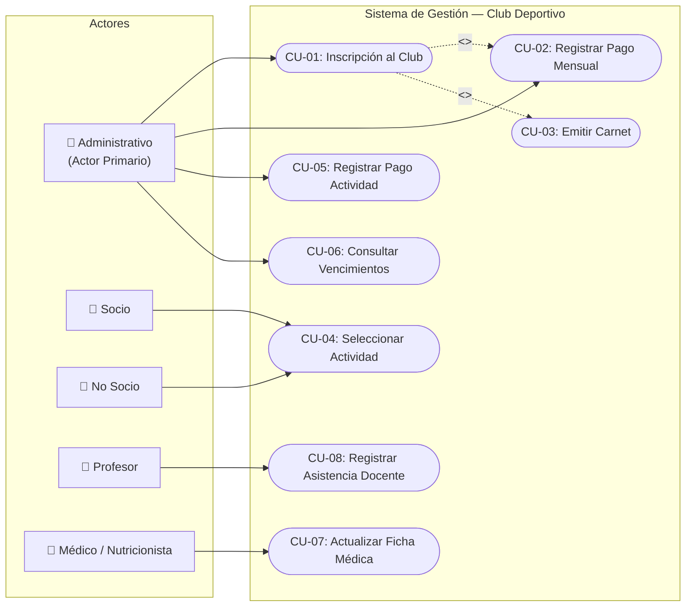
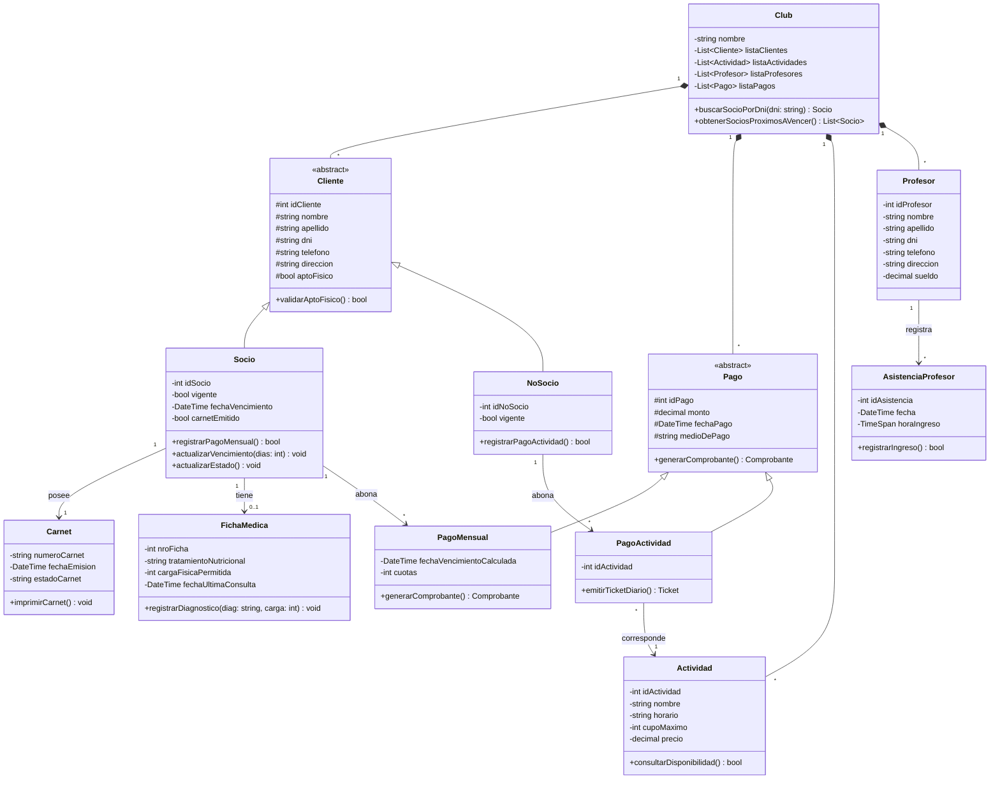
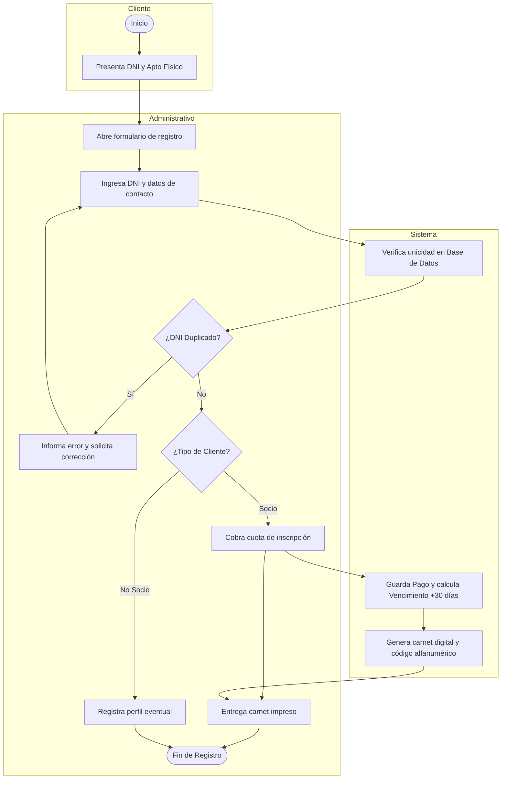
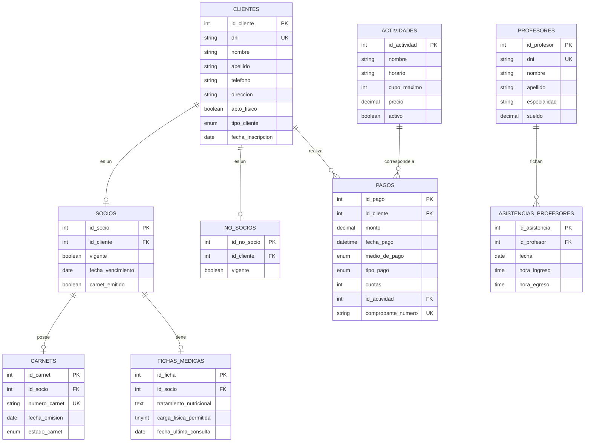

# 🏋️‍♂️ Sistema de Gestión Integral para Club Deportivo (CLUB67)
> **Análisis Funcional, Modelado de Software UML y Arquitectura en 3 Capas (.NET C# & MySQL)**  
> **Autora:** Sabrina Belén Mamaniz  
> **Especialidad:** Analista Funcional / Modelado de Sistemas / Data & Software  

[](https://dotnet.microsoft.com/)
[](https://www.mysql.com/)
[](#)
[](#)

---

## 📌 1. Descripción del Proyecto y Caso de Negocio

Este proyecto documenta y estructura el **análisis funcional, relevamiento de procesos y diseño de software** para la informatización de un **Club Deportivo y Gimnasio**. 

El sistema resuelve la problemática clásica de las instituciones deportivas: descontrol en los pagos recurrentes, falta de seguimiento en los vencimientos diarios, falta de trazabilidad en los aptos físicos de los socios y desorden en el cobro de actividades para usuarios no asociados.

### 🎯 Objetivos de Negocio Alcanzados:
* **Control estricto de cobranzas y membresías:** Diferenciación operativa entre **Socios** (cuota mensual recurrente con cálculo de 30 días acumulativos) y **No Socios** (pases eventuales por jornada y actividad).
* **Cumplimiento normativo y salud:** Obligatoriedad de certificado médico de **Apto Físico** como validación bloqueante para el alta de cualquier usuario, integrado al módulo de **Ficha Médica y Nutrición** con escala de carga física de esfuerzo permitida (1 a 5).
* **Control de acceso e inhabilitación por mora:** Bloqueo automatizado de acceso al club al cumplirse la fecha límite de pago, habilitando la reactivación inmediata una vez regularizada la cuota.
* **Trazabilidad operativa:** Fichaje horario de asistencia para el plantel docente y control de cupos por disciplina deportiva (Crossfit, Spinning, Musculación, Natación).

---

## 🏗️ 2. Arquitectura de Software

La solución fue diseñada siguiendo una **Arquitectura en 3 Capas desacopladas**, implementando patrones de diseño reconocidos en la industria:

* **Capa de Presentación (UI):** Interfaces construidas en WinForms con validaciones en tiempo real (`ErrorProvider`) y navegación fluida orientada a la experiencia de usuario (`UX/UI`).
* **Capa de Negocio (BLL):** Clases del dominio con lógica de negocio encapsulada. Implementación de **Singleton** en la clase administradora `Club` para centralizar la sesión y cachés maestras, y **Herencia / Polimorfismo** en las jerarquías de `Cliente` y `Pago`.
* **Capa de Datos (DAL):** Implementación del **Patrón Repository** y clase de conexión `Conectividad.cs`, ejecutando consultas parametrizadas contra **MySQL Server** para blindar el sistema contra inyecciones SQL.

---

## 📐 3. Diagramas de Modelado y Diseño (UML)

### 3.1 Diagrama de Casos de Uso del Sistema
Representa los límites del sistema, los actores y las relaciones de inclusión (`<<include>>`) y extensión condicional (`<<extend>>`):



---

### 3.2 Diagrama de Clases (Estructura Estática del Dominio)
Estructura orientada a objetos con tipos de datos, visibilidad, relaciones de asociación, composición y herencia:



---

### 3.3 Diagrama de Flujo y Actividades: Proceso de Inscripción
Muestra la interacción y delegación de responsabilidades mediante marcos (*swimlanes*):



---

## 🗄️ 4. Modelo de Datos Relacional (MySQL)

El modelo fue normalizado hasta **Tercera Forma Normal (3FN)** para asegurar integridad referencial y evitar anomalías de inserción, borrado y modificación:



El script SQL completo y ejecutable con constraints y seed data se encuentra disponible en:  
👉 [`database/schema.sql`](database/schema.sql)

---

## 📋 5. Reglas de Negocio Implementadas

| Regla de Negocio | Definición Funcional e Implementación Técnica |
| :--- | :--- |
| **RN-01: Apto Físico Excluyente** | Ningún cliente puede completar la inscripción ni realizar actividades sin tildar la presentación de su certificado médico legal. |
| **RN-02: Cálculo de Vencimiento de Cuota** | El ciclo de facturación es de 30 días continuos. Si un socio moroso abona fuera de término, los 30 días se computan a partir de la fecha de su vencimiento anterior para evitar salteo de períodos. |
| **RN-03: Emisión de Carnet Exclusivo** | El carnet solo se emite a miembros registrados como `Socio` que posean su cuota en estado `Vigente = true`. Los `No Socios` operan con tickets diarios. |
| **RN-04: Restricciones de Financiación** | La opción de cobro en 3 o 6 cuotas se habilita únicamente cuando el medio de pago seleccionado es `Tarjeta de Crédito`. |
| **RN-05: Control de Carga Física Nutricional** | La escala de esfuerzo físico en la ficha médica está estrictamente restringida por restricción `CHECK` entre los valores enteros 1 a 5. |

---

## 📂 6. Estructura del Repositorio

```text
├── database/
│   └── schema.sql                    # Script DDL/DML de creación de base de datos MySQL y Seed Data
├── docs/
│   ├── especificacion_casos_de_uso.md # Relevamiento funcional detallado (CU-01 a CU-08 y Contratos)
│   └── arquitectura_y_diseno_oo.md   # Explicación de arquitectura en 3 capas, Singleton y Secuencia
└── README.md                         # Memoria técnica principal del proyecto
```

---

## 🚀 7. Instrucciones de Despliegue y Puesta en Marcha

1. **Clonar el repositorio:**
   ```bash
   git clone https://github.com/SabriiAC/gestion_club_deportivo.git
   cd gestion_club_deportivo
   ```
2. **Crear e inicializar la Base de Datos:**
   * Abrir MySQL Workbench o terminal:
   ```sql
   source database/schema.sql;
   ```
3. **Configurar la cadena de conexión:**
   * Abrir la solución en **Visual Studio 2022**.
   * En `Conectividad.cs`, verificar los parámetros de conexión:
   ```csharp
   private string cadenaConexion = "Server=localhost;Database=club_deportivo_db;Uid=root;Pwd=tu_password;";
   ```
4. **Compilar y Ejecutar:** Presionar `F5` para iniciar el entorno en modo debug.

---

## 👩‍💻 Sobre la Autora
**Sabrina Belén Mamaniz**  
*Estudiante avanzada de la Tecnicatura Superior en Desarrollo de Software (IFTS N° 29, CABA).*  
*Certificada en Google Data Analytics.*  
*Locutora Nacional (UNLaM).*  

* 💼 LinkedIn: [linkedin.com/in/sabrina-mamaniz](https://www.linkedin.com/in/sabrina-mamaniz/)  
* 🐙 GitHub: [github.com/SabriiAC](https://github.com/SabriiAC)  
* 📧 Correo: [sabrinamamaniz00@gmail.com](mailto:sabrinamamaniz00@gmail.com)
