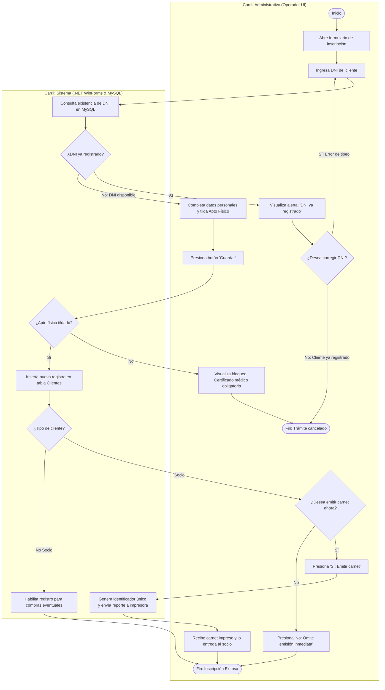
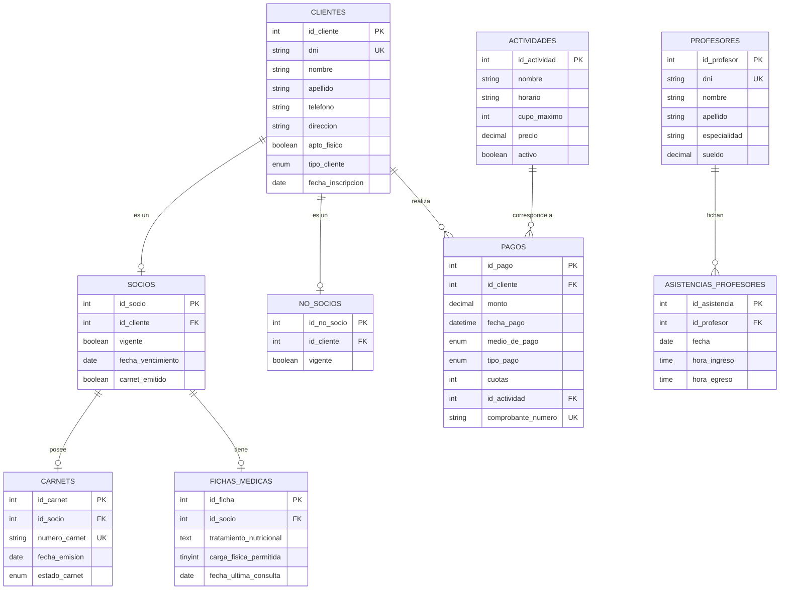

# Sistema de Gestión para Club Deportivo (CLUB67)
> Trabajo Integrador de Modelado de Software y Desarrollo Orientado a Objetos (.NET C# y MySQL)  


[](https://dotnet.microsoft.com/)
[](https://www.mysql.com/)
[](#)
[](#)

---

## Origen y Contexto del Proyecto

Desarrollé este proyecto como Trabajo Práctico Integrador para las materias **Modelado y Diseño de Software** y **Desarrollo de Software Orientado a Objeto** del IFTS N° 29. 

El objetivo era modelar e implementar el circuito operativo de un club deportivo barrial: administración de socios, cobro de aranceles, control de accesos por cuota al día, relevación de la consulta de nutrición y registro de ingreso del personal. 

En vez de limitarme a una interfaz visual simple, encaré el proyecto desde la ingeniería de software: primero relevé los procesos y reglas del negocio, después modelé la solución con diagramas UML formales y finalmente construí la arquitectura en capas conectada a MySQL.

---

## Decisiones de Negocio y Reglas que Implementé

Cuando analicé el funcionamiento del club, identifiqué cinco reglas clave que debían reflejarse en el sistema:

1. **Diferenciación entre Socios y No Socios:** Los socios pagan una cuota mensual recurrente que les permite acceder a las instalaciones. Los no socios solo abonan un pase diario para la actividad puntual que eligen en el día.
2. **Cálculo de vencimientos a 30 días continuos:** Si un socio se atrasa y paga fuera de término, los 30 días no se cuentan desde el día del pago, sino a partir de la fecha de su vencimiento anterior. De esta manera, el club evita que un socio saltee períodos impagos.
3. **Apto físico obligatorio:** Ningún cliente puede completar su registro ni participar en actividades sin presentar el certificado médico. En el sistema, la validación del apto bloquea el guardado si no está tildada la recepción del documento.
4. **Carnet exclusivo para socios al día:** El carnet con identificador único solo se genera para socios con cuota vigente. 
5. **Financiación con tarjeta:** El cobro en 3 o 6 cuotas se restringe únicamente al medio de pago tarjeta de crédito.

---

## Arquitectura del Software

Organicé el código en tres capas separadas para que cada componente tenga una única responsabilidad:

* **Capa de Presentación (UI):** Formularios de escritorio en WinForms (C#) con validaciones en tiempo real para evitar campos vacíos o formatos inválidos.
* **Capa de Negocio (BLL):** Clases del dominio con las reglas del club. Utilicé el patrón creacional **Singleton** en la clase `Club` para mantener una única instancia administradora en memoria con las listas maestras, y apliqué herencia tanto en clientes (`Cliente` -> `Socio` / `NoSocio`) como en pagos (`Pago` -> `PagoMensual` / `PagoActividad`).
* **Capa de Datos (DAL):** Apliqué el patrón **Repository** mediante clases específicas de acceso a datos (`ClienteDatos.cs`, `PagoDatos.cs`, etc.) y una clase central `Conectividad.cs`. Todas las consultas contra MySQL utilizan parámetros para evitar inyecciones SQL.

---

## Diagramas del Sistema (UML)

### Casos de Uso
El siguiente diagrama resume los límites del sistema, los actores que intervienen y las relaciones entre operaciones:


---

### Diagrama de Clases del Dominio
Muestra la jerarquía de herencia, métodos y multiplicidades del sistema:


---

### Flujo de Actividades: Inscripción al Club
Proceso dividido en carriles para delimitar responsabilidades entre el cliente, el administrativo y el sistema:



---

## Base de Datos (MySQL)

Diseñé la estructura relacional normalizada en 3FN con claves foráneas e índices en DNI y fechas de vencimiento:



El script SQL completo para recrear las tablas y cargar datos de prueba está en [`database/schema.sql`](database/schema.sql).

---

## Estructura de la Documentación

```text
├── database/
│   └── schema.sql                    # Script DDL/DML de creación de tablas y datos iniciales en MySQL
├── docs/
│   ├── especificacion_casos_de_uso.md # Relevamiento detallado de casos de uso (CU-01 al CU-08) y contratos
│   └── arquitectura_y_diseno_oo.md   # Explicación de la arquitectura en 3 capas, Singleton y secuencia
└── README.md                         # Este documento
```

---


---

##  Manual de Usuario

Podes ver el funcionamiento operativo de cada módulo de la aplicación con sus pantallas y flujos detallados:

👉 **[Abrir Manual de Usuario (PDF)](MANUAL%20DE%20USUARIO.pdf)**
