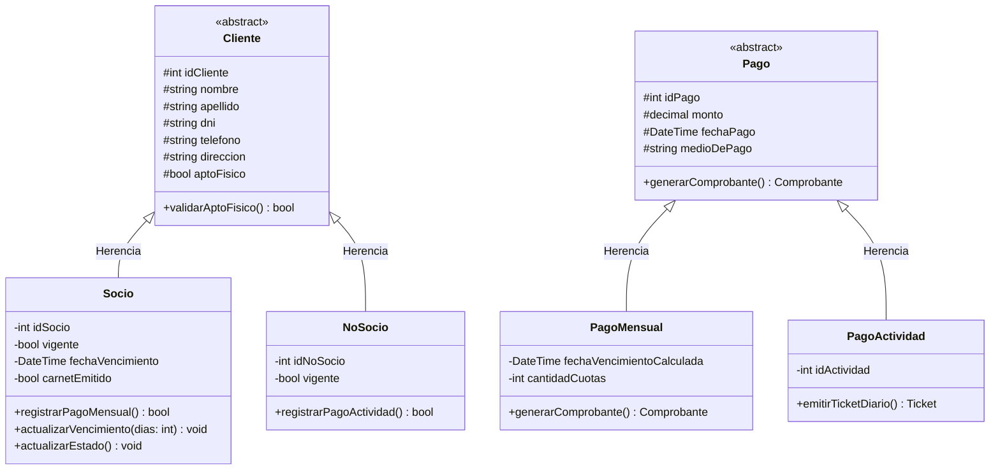
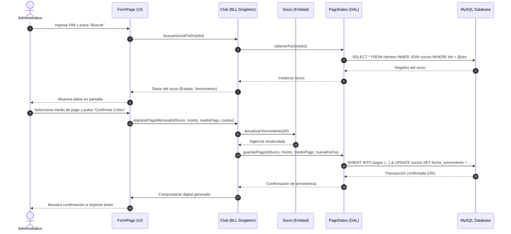
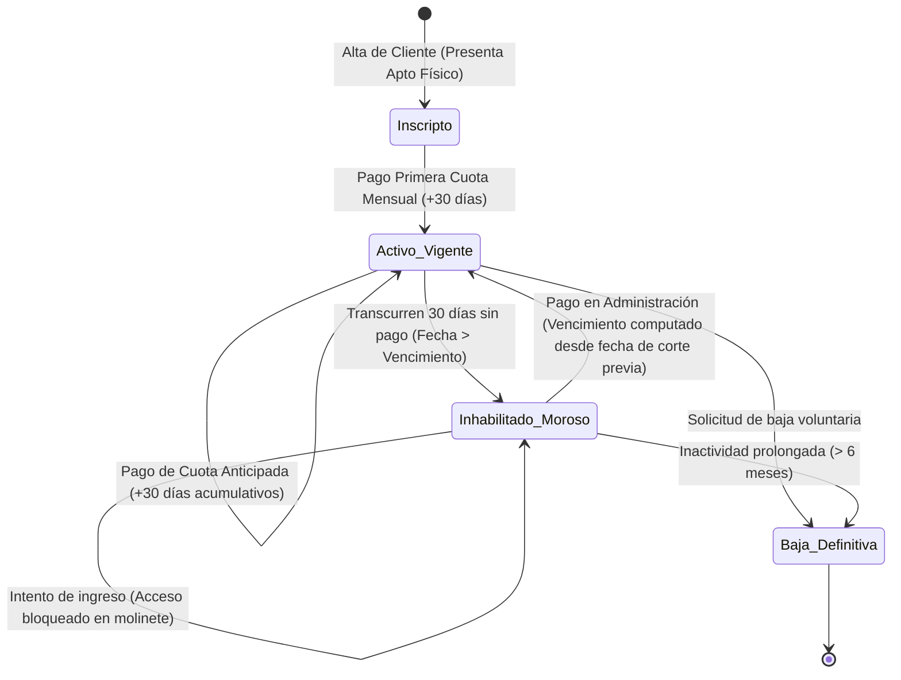

# Arquitectura de Software y Diseño Orientado a Objetos
**Sistema de Gestión — Club Deportivo (CLUB67)**  
*Documento de Diseño Técnico y Arquitectura de Sistemas*  
*Autora:* **Sabrina Belén Mamaniz**  

---

## 1. Patrón Arquitectónico en Tres Capas (3-Tier Layered Architecture)

El sistema implementa una arquitectura desacoplada en tres capas para garantizar mantenibilidad, testeo independiente y clara separación de responsabilidades:

```
┌────────────────────────────────────────────────────────┐
│           1. CAPA DE PRESENTACIÓN (UI)                 │
│  WinForms (.NET / C#)                                  │
│  Login.cs, Home.cs, Inscripcion.cs, Pago.cs,           │
│  Profesor.cs, ServicioNutricion.cs                     │
└──────────────────────────┬─────────────────────────────┘
                           │ (Peticiones de UI / DTOs)
                           ▼
┌────────────────────────────────────────────────────────┐
│             2. CAPA DE NEGOCIO (BLL)                   │
│  Reglas de Dominio, Validaciones y Modelos POO         │
│  Club.cs (Singleton), Cliente.cs, Socio.cs,            │
│  NoSocio.cs, Pago.cs, Carnet.cs, FichaMedica.cs        │
└──────────────────────────┬─────────────────────────────┘
                           │ (Llamadas a repositorios)
                           ▼
┌────────────────────────────────────────────────────────┐
│              3. CAPA DE DATOS (DAL)                    │
│  Persistencia & Conectividad (MySQL 8.0)               │
│  Conectividad.cs, ClienteDatos.cs, PagoDatos.cs,       │
│  ProfesorDatos.cs, FichaMedicaDatos.cs                 │
└────────────────────────────────────────────────────────┘
```

### Detalle de Responsabilidades por Capa:
1. **Capa de Presentación:** Captura eventos de usuario, valida entradas a nivel tipográfico/campos vacíos (`ErrorProvider`), invoca métodos de la capa de negocio y renderiza retroalimentación visual al administrativo.
2. **Capa de Negocio:** Encapsula la lógica de dominio (cálculo de vigencia de 30 días, reglas de inhabilitación por mora, validación de apto físico, emisión condicional de carnets y cálculo de comisiones/cuotas con tarjeta).
3. **Capa de Datos:** Gestiona la apertura y cierre de conexiones mediante `MySqlConnection`, ejecuta consultas parametrizadas para prevenir inyecciones SQL (`SQL Injection`) y mapea los resultados (`DataReaders`) hacia objetos del dominio.

---

## 2. Patrones de Diseño Implementados

### 2.1 Patrón Creacional: Singleton (`Club.cs`)
* **Propósito:** Garantizar que exista una **única instancia** en memoria durante todo el ciclo de vida de la aplicación para centralizar el acceso a la configuración del club, sesiones de usuario y cachés de listas maestras (actividades y docentes).
* **Implementación:**
  - Constructor privado para impedir instanciación externa directa.
  - Atributo estático `private static Club _instancia`.
  - Propiedad de acceso global `public static Club Instancia` con inicialización controlada (*lazy initialization* o inicialización estática segura para entornos multi-hilo).

### 2.2 Patrón Estructural / Acceso a Datos: Repository Pattern
* **Propósito:** Mediar entre la capa de dominio y la capa de mapeo de datos, actuando como una colección en memoria de objetos de dominio.
* **Beneficio:** Si en el futuro se migra el motor de base de datos de MySQL a PostgreSQL o SQL Server, únicamente se reemplazan las clases de la carpeta `Datos/` sin alterar una sola línea de código en la capa de negocio ni en los formularios.

### 2.3 Herencia y Polimorfismo en el Modelo de Dominio



---

## 3. Diagrama de Secuencia: Cobro y Acreditación de Cuota Mensual

Modela el flujo de llamadas e interacción temporal entre componentes al registrar un pago:



---

## 4. Diagrama de Estados: Ciclo de Vida de la Membresía del Socio


